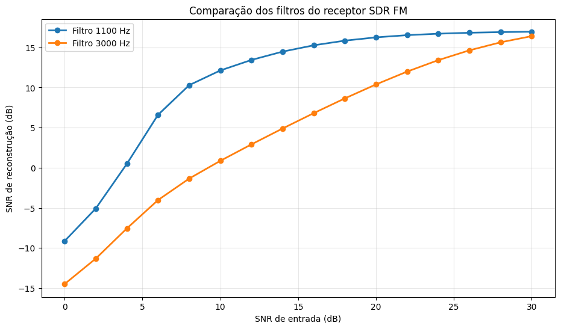

# Software-Defined FM Receiver Using Python

Design, Simulation and Performance Evaluation

Project Overview

This project presents the development and performance evaluation of a software-based FM receiver using Python and Google Colab.

The system simulates FM transmission and reception using complex IQ signals, an Additive White Gaussian Noise (AWGN) channel, FM demodulation, and digital Butterworth filtering.

Real voice recordings are used to evaluate the recovered audio under different channel conditions.

## System Architecture

Audio Input → FM Modulator → AWGN Channel → FM Demodulator → Low-Pass Filter → Recovered Audio

## Main Features

- FM modulation and demodulation in complex baseband
- AWGN channel simulation with adjustable SNR
- Spectrum and waterfall visualization
- Interactive receiver interface
- Audio reconstruction and playback
- Butterworth low-pass filter optimization
- Performance evaluation using MSE and reconstruction SNR
- Validation with two voice recordings

## Experimental Results
### FM Receiver Performance

Filter Optimization

For the first voice recording, a cutoff frequency of 1,100 Hz provided the highest reconstruction SNR among the tested frequencies.

Performance Comparison

At an input SNR of 20 dB, the optimized 1,100 Hz filter achieved approximately 16.2 dB reconstruction SNR, compared with 10.4 dB for the 3,000 Hz filter.

Validation

Using a second voice recording at an input SNR of 20 dB:

| Filter cutoff | Reconstruction SNR |
|---|---|
| 1,100 Hz | Approximately 12.8 dB |
| 3,000 Hz | Approximately 9.8 dB |

The results indicate that the optimized filter improved reconstruction quality under the evaluated conditions.

## Technologies

Python, NumPy, SciPy, Matplotlib, ipywidgets and Google Colab.

## How to Run

1. Open `SDR_30_10_2026.ipynb` in Google Colab.
2. Execute the notebook cells in order.
3. Upload a voice recording when prompted.
4. Adjust the SNR and filter cutoff frequency.
5. Analyze the spectrum, waterfall and recovered audio.

## Limitations

This is a software-only FM receiver simulation in complex baseband. It does not perform real-time RF reception or require SDR hardware.

The filter optimization results are specific to the tested recordings and simulation parameters.

## Future Work

- Improved audio noise reduction
- Comparison with alternative demodulation methods
- Real-time audio processing
- Integration with SDR hardware for over-the-air reception
